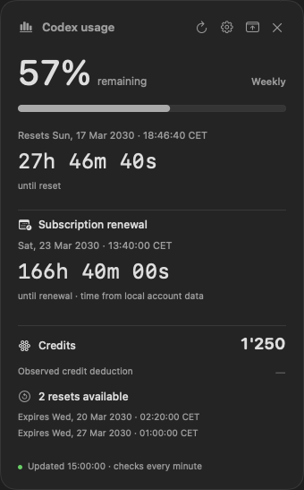
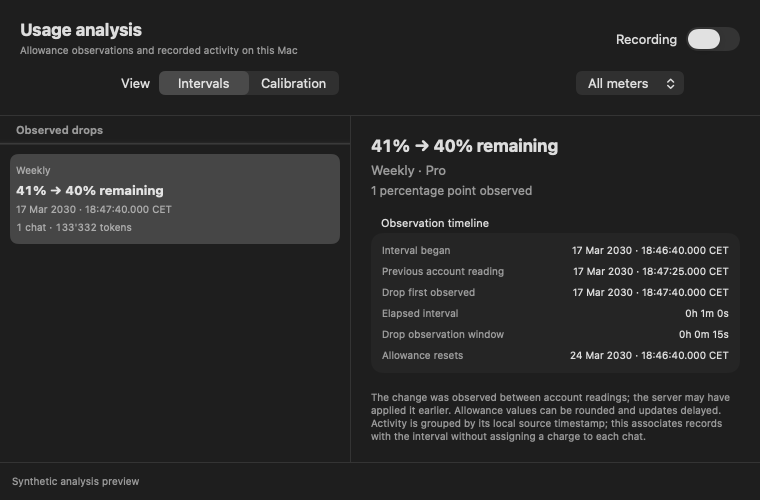

# Codex Usage Monitor

A native macOS app for keeping an eye on your Codex usage. See your remaining allowance and reset countdown in a floating window or a menu bar card, without opening Codex.



*Screenshots show synthetic example data.*

## What it shows

- Remaining allowance for the usage windows returned by Codex, with reset dates in your local time zone and live countdowns.
- Available reset credits, expiry dates, and account credit balance when reported.
- A subscription renewal date from cached local sign-in metadata, when available. This date is provisional and is not a live billing confirmation.
- Optional **Usage Analysis** that relates observed allowance drops to local chat activity and estimates tokens per percentage point for eligible intervals.

The floating window can be moved across displays and restored from the menu bar or Dock. Settings control those entry points, countdown format, and optional launch at login. The app uses a single shared monitor even when the window is hidden.

## Requirements

- macOS 14 or later
- A local Codex installation signed in with ChatGPT
- An internet connection for current usage readings
- Swift 5.10 or later to build from source

There are no third-party package dependencies.

## Run from source

Clone the repository, then run:

```sh
swift run CodexUsageMonitor
```

You can also build an optimized executable and run the test suite:

```sh
swift build -c release
swift test
```

The performance tests use fixed timing limits and can fail on a heavily loaded machine.

To create a local app bundle, run `./scripts/build.sh`. It builds `dist/Codex Usage Monitor.app` with an ad hoc signature. Move the bundle to `~/Applications` to use the optional Launch at login setting; a source executable alone cannot register it. The bundle is not notarized for distribution, and macOS may require additional approval to open or register it.

If Codex is not found, set `CODEX_USAGE_CODEX_PATH` to the path of the Codex executable. If you use a custom `CODEX_HOME`, launch the monitor with the same environment so it reads the intended account and local records.

## Using the app

Open **Settings** from the gear button, the menu bar's right-click menu, or with ⌘,. Choose menu bar, Dock, or both; at least one entry point stays enabled. Closing the floating window leaves the monitor running. Use **Quit** to stop it. **Launch at login** is optional and managed by macOS.

Use the refresh button or ⌘R to request a fresh reading. Usage normally refreshes every 60 seconds, every 15 seconds while analysis recording is enabled, and every 10 seconds while credits are in use. It also refreshes on wake and around known reset or expiry times. A failed refresh marks retained values as last known; after a reset time passes, the percentage is hidden until a fresh reading confirms the window.

Open **Usage Analysis…** with ⌘3 and enable recording there or in Settings. Recording is optional. The Intervals view shows observed drops alongside local activity; Calibration summarizes eligible observations by model and settings. Disabling recording stops collection but retains saved data.



Analysis is an estimate, not a billing report. Allowance changes are observed at refresh times, local records may be incomplete, and activity on other devices may be missing. The app cannot determine exact server debit times, per-chat charges, or the service's hidden billing formula. Some intervals are excluded from calibration when their evidence is incomplete or ambiguous.

## How it works and privacy

For each usage refresh, the app starts the local `codex app-server`, initializes it, and requests `account/rateLimits/read`. Codex uses its existing authentication to contact OpenAI; the helper exits after the read. The monitor does not initiate model turns, purchase credits, or redeem resets.

For subscription renewal, the app reads selected account and date claims from the local Codex `auth.json` and checks them against the account returned by the usage reader. It does not log, save, transmit, or refresh the token. Missing or mismatched metadata is shown as unavailable.

When analysis recording is enabled, the app reads the local Codex index, matching account activity files, and selected configuration evidence. It stores usage observations and selected activity metadata locally, including chat titles, project identifiers, timestamps, model settings, and token counts. Chat titles and project metadata can themselves contain sensitive information. The new analysis tables do not store raw prompt or message bodies, tool arguments, credentials, or raw token-event JSON. Existing legacy history is retained separately. The source records are read-only.

Analysis data is stored at `~/Library/Application Support/local.codex-usage-monitor/history.sqlite`, grouped by a hashed account identity. Turning recording off retains the database. Account snapshots otherwise remain in memory. No separate background daemon is installed.

The app depends on Codex's local files and [app-server protocol](https://learn.chatgpt.com/docs/app-server#6-rate-limits-chatgpt), which can change. Missing data and read errors are shown rather than filled in with guessed values.
